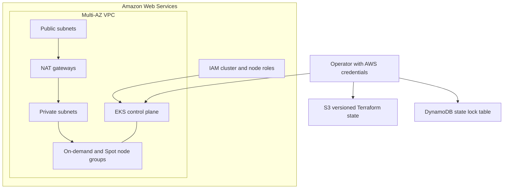

# Terraform AWS EKS Starter

Reusable Terraform infrastructure for a private-subnet Amazon EKS cluster. The root configuration composes local VPC, EKS, and IAM modules; a separate bootstrap stack creates the S3 and DynamoDB resources used for remote state and locking.

## Architecture



## Repository layout

- `modules/vpc`: multi-AZ VPC, public/private subnets, route tables, and NAT gateways.
- `modules/eks`: EKS control plane, managed node groups, encryption, and control-plane logs.
- `modules/iam`: cluster and worker roles with the policies required by EKS.
- `bootstrap`: S3 state bucket and DynamoDB lock table, managed separately from workload state.
- `dev.tfvars.example` and `prod.tfvars.example`: safe-to-commit environment examples. Copy one to a local `*.tfvars` file if preferred; that local file remains ignored.

## Prerequisites

- Terraform 1.5 or later (CI uses 1.9.8).
- AWS CLI credentials with permission to create the listed networking, IAM, EKS, KMS, CloudWatch Logs, S3, and DynamoDB resources.
- An AWS region with at least three available Availability Zones for the defaults.
- Replace `203.0.113.10/32` in the selected variables file with your trusted public IP range before creating the cluster. It is a documentation-only range.

## How to run

First create the remote-state resources. This bootstrap uses local state, so run it from its own directory and retain its state file securely:

```bash
cd bootstrap
terraform init
terraform apply -var="state_bucket_name=replace-with-a-globally-unique-name" -var="region=ap-south-1"
terraform output
```

Return to the repository root and initialize workload state with the bucket and lock table reported by bootstrap. Keep a distinct state key for each environment:

```bash
cd ..
terraform init \
  -backend-config="bucket=replace-with-bootstrap-bucket" \
  -backend-config="key=eks/dev/terraform.tfstate" \
  -backend-config="region=ap-south-1" \
  -backend-config="dynamodb_table=replace-with-bootstrap-lock-table" \
  -backend-config="encrypt=true"
terraform plan -var-file=dev.tfvars.example
terraform apply -var-file=dev.tfvars.example
```

For production, use `prod.tfvars.example` and a production-specific state key such as `eks/prod/terraform.tfstate`. Do not reuse the development key. After applying, run `terraform output -raw kubeconfig_command` to configure `kubectl`. The API endpoint is restricted to the configured CIDRs; private-subnet workers use NAT for outbound access.

CI runs formatting, validation, TFLint, and tfsec. It does not need AWS credentials and never applies infrastructure.

## Cleanup

From the root directory, destroy the cluster and networking with the same environment variables and backend key used to create them:

```bash
terraform destroy -var-file=dev.tfvars.example
```

Only after all workload state has been destroyed and is no longer needed, remove the bootstrap resources:

```bash
cd bootstrap
terraform destroy -var="state_bucket_name=replace-with-a-globally-unique-name" -var="region=ap-south-1"
```

S3 state deletion is irreversible. Download and retain any state you need before destroying the bootstrap stack. EKS control planes, NAT gateways, KMS keys, and compute incur AWS charges while provisioned.

## What I learned

- Remote state and its lock table must exist before a workload backend can initialize; a separate bootstrap state avoids a dependency loop.
- Separate IAM, networking, and cluster modules clarify ownership and review boundaries.
- Restricting the public Kubernetes API to explicit CIDRs and placing worker nodes in private subnets reduces unnecessary exposure.
- Terraform validation can run without AWS credentials, while an apply still needs carefully scoped cloud permissions.
