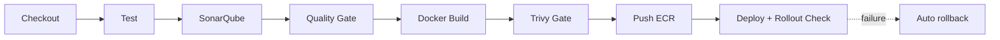

# Jenkins DevSecOps Pipeline

A declarative Jenkins pipeline that takes a containerized app from commit to Kubernetes with quality and security gates. A reference implementation of the CI/CD pattern behind my production work (40% release-cycle reduction at TCS).



## Highlights
- **Quality gate**: SonarQube result blocks the pipeline
- **Security gate**: Trivy fails the build on fixable HIGH/CRITICAL vulnerabilities
- **Immutable tags**: build-number tags, no `latest`
- **Safe deploys**: rolling update with `maxUnavailable: 0`, `rollout status` check, automatic `rollout undo` on failure
- **Hardened workload**: non-root, dropped capabilities, probes, resource limits, HPA at 70% CPU

## Setup
1. Jenkins plugins: Pipeline, SonarQube Scanner, Docker, AWS credentials
2. Configure a SonarQube server named `sonarqube`
3. Replace `<aws_account_id>` and region in the `Jenkinsfile`
4. Agent needs `docker`, `trivy`, `aws`, `kubectl` and a kubeconfig for the target cluster

## Layout
```
app/         sample Flask service
k8s/         deployment, service, HPA
Dockerfile   non-root, healthcheck
Jenkinsfile  pipeline definition
```
